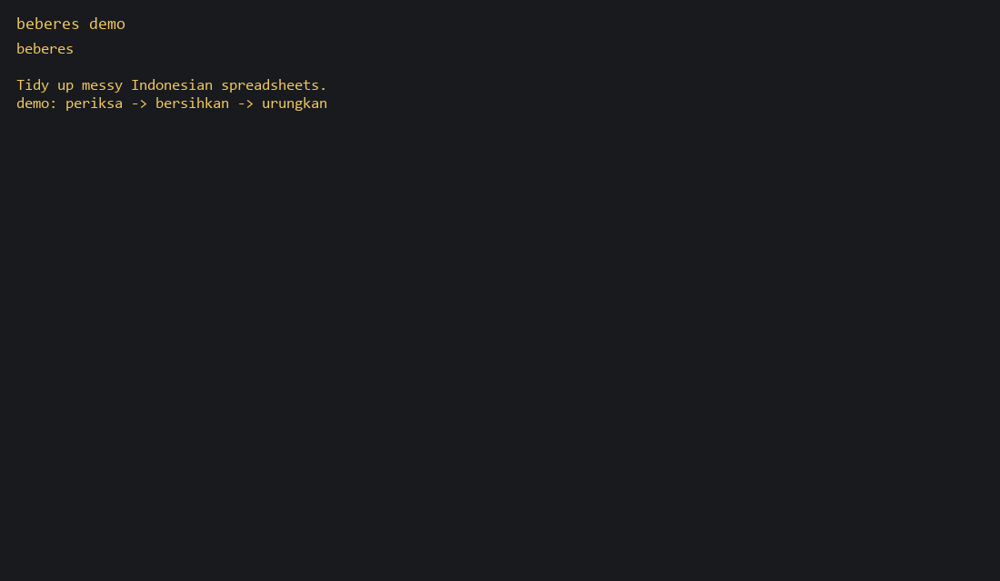

# beberes

> *Tidy up messy Indonesian spreadsheets.*
> Engine kualitas data untuk file Excel/CSV yang berantakan, dibuat untuk kebiasaan data Indonesia.

🇬🇧 [English version](README.md)

**Status:** v0.5.0 — UI lokal di browser (`beberes ui`), dedupe, undo, mode konfirmasi, benchmark akurasi, wilayah resmi



## Masalahnya

Data dari kantor desa, sekolah, panitia kegiatan, dan UMKM hampir selalu berantakan:
tanggal campur format, "Rp 25.000" tersimpan sebagai teks, nama dobel dengan ejaan beda,
nama daerah typo, kolom kosong di mana-mana. Dirapikan manual itu lama dan rawan salah.
Tools data cleaning yang ada umumnya ditujukan ke data scientist, bukan admin non-teknis,
dan tidak paham format Indonesia (NIK, NPWP, plat, Rupiah, gelar, wilayah).

## Cara kerja (alur)

```
baca file -> profil kolom -> deteksi masalah -> usul perbaikan -> terapkan -> laporan + audit log
```

Semua proses berjalan **lokal**. Tidak ada data yang dikirim keluar dari komputer.

## Rencana penggunaan

```bash
pip install beberes

# lihat masalah tanpa mengubah apa pun (default aman)
beberes periksa data.xlsx          # alias Inggris: beberes check

# terapkan perbaikan, simpan ke file baru + laporan + audit log
beberes bersihkan data.xlsx --keluar data_bersih.xlsx --laporan   # alias: beberes clean

# aturan domain Indonesia (NIK, HP, wilayah, dll.)
beberes bersihkan data.xlsx --aturan peserta.yaml

# konfirmasi interaktif untuk perbaikan ambigu (tanggal dd/mm, gelar, dll.)
beberes bersihkan data.xlsx --konfirmasi

# undo perubahan dari audit log
beberes urungkan data_bersih.xlsx --log data_bersih.audit.jsonl --keluar dipulihkan.xlsx

# bahasa pesan/laporan: id atau en (default mengikuti bahasa sistem)
beberes periksa data.xlsx --bahasa en

# antarmuka lokal di browser
beberes ui
```

## Dokumentasi

| File | Isi |
|---|---|
| [docs/01-visi-dan-ruang-lingkup.md](docs/01-visi-dan-ruang-lingkup.md) | Tujuan, target user, non-goals, kriteria sukses |
| [docs/02-arsitektur.md](docs/02-arsitektur.md) | Lapisan, modul, alur data, struktur folder |
| [docs/03-spesifikasi-aturan-dan-laporan.md](docs/03-spesifikasi-aturan-dan-laporan.md) | Format YAML, kode masalah, format laporan & audit log |
| [docs/04-rencana-data-uji.md](docs/04-rencana-data-uji.md) | Sumber data, generator data sintetis, metrik, aturan privasi |
| [docs/05-validasi-user.md](docs/05-validasi-user.md) | Cara cari user, pertanyaan wawancara, log umpan balik |
| [docs/06-keputusan-dan-risiko.md](docs/06-keputusan-dan-risiko.md) | Log keputusan desain + daftar risiko |
| [docs/07-aturan-yaml.md](docs/07-aturan-yaml.md) | Cara menulis aturan YAML sendiri (tipe kolom, kode masalah, contoh) |
| [docs/benchmark.md](docs/benchmark.md) | Benchmark akurasi pada data sintetis (recall + akurasi perbaikan) |
| [docs/demo-gif.md](docs/demo-gif.md) | Skenario demo untuk GIF |
| [CLAUDE.md](CLAUDE.md) | File konteks untuk asisten AI coding |
| [ROADMAP.md](ROADMAP.md) | Versi dan checklist per versi (tanpa tanggal) |
| [CHANGELOG.md](CHANGELOG.md) | Riwayat perubahan |
| [CONTRIBUTING.md](CONTRIBUTING.md) | Cara berkontribusi |

## Lisensi

Belum ditentukan (lihat keputusan D-007).
