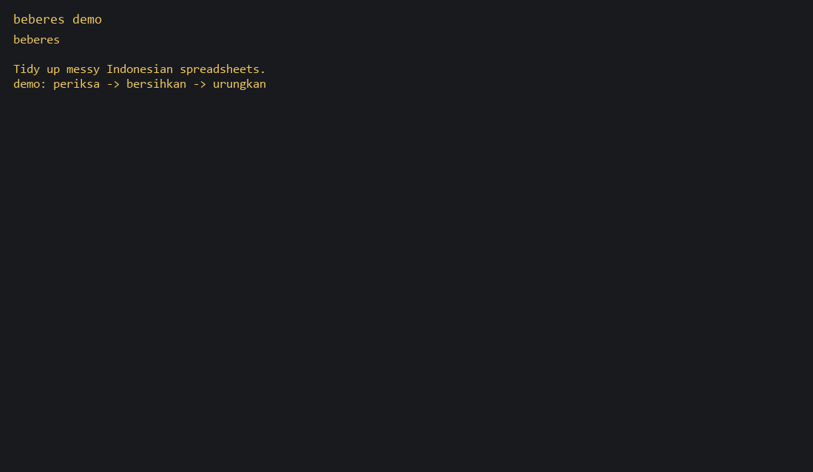

# beberes

> *Tidy up messy Indonesian spreadsheets.*
> A data-quality engine for messy Excel/CSV files, built for how Indonesian data actually looks.

🇮🇩 [Versi Bahasa Indonesia](README.id.md)

**Status:** v0.3.2 — dedupe, undo, mode konfirmasi, benchmark akurasi, wilayah resmi



*"Beberes"* is Indonesian for "tidying up". It does that to your data.

## The problem

Spreadsheets from village offices, schools, event committees, and small businesses are almost always a mess:
mixed date formats, "Rp 25.000" stored as text, the same person spelled three ways, misspelled place names,
empty cells everywhere. Cleaning them by hand is slow and error-prone. Existing data-cleaning tools target
data scientists and don't understand Indonesian formats (NIK, NPWP, plate numbers, Rupiah, honorifics, administrative regions).

## How it works

```
read file -> profile columns -> detect issues -> propose fixes -> apply -> report + audit log
```

Everything runs **locally**. No data leaves your computer.

## Usage

```bash
pip install beberes

# inspect only, change nothing (safe default)
beberes check data.xlsx          # Indonesian alias: beberes periksa

# apply fixes, write a new file + report + audit log
beberes clean data.xlsx --out data_clean.xlsx --report    # alias: beberes bersihkan

# Indonesian-domain rules (NIK, HP, wilayah, dll.)
beberes clean data.xlsx --rules peserta.yaml               # alias: --aturan

# confirm ambiguous fixes interactively (dates dd/mm, gelar, dll.)
beberes clean data.xlsx --confirm

# undo changes from an audit log
beberes undo data_clean.xlsx --log data_clean.audit.jsonl --out restored.xlsx

# message language: id or en (defaults to system language)
beberes check data.xlsx --lang en

# (v0.5) local browser UI
beberes ui
```

> CLI flags have both Indonesian and English forms (e.g. `--keluar`/`--out`, `--laporan`/`--report`, `--aturan`/`--rules`, `--bahasa`/`--lang`).

## Why it's different

- **Indonesian-aware:** NIK / NPWP / phone / plate validators, region-name normalization, Rupiah and `dd/mm/yyyy` handling, honorifics in names
- **Safe by design:** dry-run by default, original files never overwritten, every change logged and undoable
- **Deterministic:** same input, same output; rules are plain YAML
- **Offline and light:** runs on an ordinary laptop, no GPU, no cloud

## Documentation

Detailed docs are currently written in Indonesian (English summaries come with v0.1).

| File | Contents |
|---|---|
| [docs/01-visi-dan-ruang-lingkup.md](docs/01-visi-dan-ruang-lingkup.md) | Vision, target users, non-goals, success criteria |
| [docs/02-arsitektur.md](docs/02-arsitektur.md) | Layers, modules, data flow, repo structure |
| [docs/03-spesifikasi-aturan-dan-laporan.md](docs/03-spesifikasi-aturan-dan-laporan.md) | YAML rule format, issue codes, report & audit-log format |
| [docs/04-rencana-data-uji.md](docs/04-rencana-data-uji.md) | Test data sources, synthetic generator, metrics, privacy rules |
| [docs/05-validasi-user.md](docs/05-validasi-user.md) | Finding users, interview questions, feedback log |
| [docs/06-keputusan-dan-risiko.md](docs/06-keputusan-dan-risiko.md) | Design decision log + risks |
| [docs/07-aturan-yaml.md](docs/07-aturan-yaml.md) | Writing your own YAML rules (column types, codes, examples) |
| [docs/benchmark.md](docs/benchmark.md) | Accuracy benchmark on synthetic data (recall + fix accuracy) |
| [docs/demo-gif.md](docs/demo-gif.md) | Demo scenario script for the GIF |
| [CLAUDE.md](CLAUDE.md) | Context file for AI coding assistants |
| [ROADMAP.md](ROADMAP.md) | Versions and checklists (no dates) |
| [CHANGELOG.md](CHANGELOG.md) | Change history |
| [CONTRIBUTING.md](CONTRIBUTING.md) | How to contribute (issues in English or Indonesian are welcome) |

## License

Not decided yet (see decision D-007).
